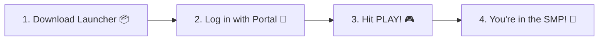

# ⚡ Lampas Launcher

> **The zero-braincells, 1-click way to play Lampas SMP.**  
> No Prism, no CurseForge, no _"hey why is my mod version different than the server"_ pain. Just click **PLAY** and jump straight in! 🚀

[](https://github.com/justbecauseph/lampas-launcher/releases/latest)

---

## 🎮 What is this?

Welcome to the **Lampas Launcher**! It is our custom-built desktop app that handles _everything_ so you can spend less time fixing crashes and more time building dirt huts, dying to creepers, and having fun on Lampas SMP.

### ✨ Why you'll love it:

- 🟢 **1-Click Login**: Log in with your browser. It automatically checks your Discord whitelist, hooks up your Minecraft account, and you're ready to go.
- 📦 **Auto-Magic Mod Updates**: Whenever the server gets new mods, updates, or configs, your launcher updates them automatically before the game starts. Zero drift, zero headache.
- ☕ **No Java? No Problem**: Minecraft 26.2 needs Java 25. Don't have it? Don't even know what Java is? The launcher will download and install the official Java runtime for you automatically in the background.
- ⚡ **Quick Play (Auto-Connect)**: Hit **PLAY** and the game boots straight into the Lampas server. No typing server IPs or clicking through multiplayer menus.
- 🎨 **Brings Your Resource Packs**: Required server resource packs are downloaded and turned on for you automatically. Your custom packs and settings stay completely untouched.
- 🧩 **Add Your Own Mods**: Want your favorite zoom mod, shader pack, or HUD tweaks? Just drag and drop them into the **Client Mods** tab!
- 👀 **Live Server Status**: Check if the server is online and see who's currently playing before you even launch the game.
- 💽 **Ran out of C: Drive space?**: You can move your entire game folder to your D: drive (or anywhere else) right from the settings without breaking anything.
- 🔧 **Repair Button**: Game acting weird? Press **Repair** to run a full cryptographic SHA-256 verification of every managed mod, configuration, asset index, and Fabric runtime library, replacing any corrupt files.

---

## 📥 How to Install & Play

Getting started takes about 30 seconds:



1. **Download the latest release**:
   - Grab the installer from [**GitHub Releases (Latest)**](https://github.com/justbecauseph/lampas-launcher/releases/latest).
   - **Windows**: Download `LampasLauncher-Setup-<version>.exe` (Installer) or `LampasLauncher-<version>-Windows.exe` (Portable).
   - **Linux**: Download `LampasLauncher-<version>-Linux.AppImage` (make executable & run) or `.tar.gz`.
2. **Log in**:
   - Click **Login with Lampas Portal**.
   - Your browser will open. Authorize your account, link your Minecraft username, and boom — you're logged in!
3. **Hit PLAY**:
   - The launcher will grab the newest mods, prepare Java, and launch Minecraft straight into Lampas.

---

## 🕹️ Launcher Tour

| Tab                | What it's for                                                                                                                        |
| ------------------ | ------------------------------------------------------------------------------------------------------------------------------------ |
| **🚀 Play**        | The main dashboard. See server status, who's online, pick your channel (`Stable`, `Beta`, `Dev`), and press the big **PLAY** button. |
| **🧩 Client Mods** | Toggle official optional mods or drop your own `.jar` files here.                                                                    |
| **📜 Console**     | Live logs while your game is running. If something goes wrong, you can search and copy errors here to send to staff.                 |
| **⚙️ Settings**    | Allocate more RAM (slider), change game directory, customize Java settings, or view your logs.                                       |

---

## ❓ FAQ & Troubleshooting

### 🛑 "It says my Minecraft account isn't bound!"

Head over to the [Lampas Portal](https://dev.lampas.town) dashboard, link your Minecraft Java username to your account, and hit login again in the launcher!

### 💥 "My game crashed or won't start!"

1. Click the **Repair** button on the Play tab. This checks every single file against the server and replaces anything that broke.
2. If it still crashes, head to the **Console** tab, click **Copy Logs**, and paste them in the Discord `#support` channel!

### 💾 "Will updating delete my worlds, screenshots, or keybinds?"

**Nope!** Your `saves/`, `screenshots/`, `logs/`, `servers.dat`, and custom `options.txt` settings are strictly protected and will never be overwritten or deleted.

### 🧩 "How does config file ownership work?"

Lampas uses a 3-tier ownership model for mod configurations:

- **`MANAGED`**: Lampas owns the whole file. Required files are synchronized and verified; obsolete files are deleted.
- **`PRESERVE`**: You or the mod own the file. Lampas only seeds initial files if missing.
- **`CONFIG PATCH / enforce`**: You own the config file; Lampas only enforces declared properties (e.g. turning off Hypixel-only chat tabs in `config/chatting.json`). Your personal settings, volume sliders, formatting, and comments stay intact!
- **`CONFIG PATCH / once`**: Lampas seeds recommended values once, then relinquishes ownership to you.

---

## 🤓 For Nerds & Developers

If you want to build or tinker with the launcher code locally:

### Supported Platforms & Runtime Requirements

- **Supported Target Platforms:**
  - **Windows (x64):** Windows 10, Windows 11 (NSIS installer & portable `.exe`).
  - **Linux (x64):** Modern glibc distributions (AppImage & `.tar.gz`).
- **Tooling Requirements:**
  - **Bun:** `v1.4.2` (pinned in CI)
  - **Node.js:** `>=22.12.0` (Node 24 LTS recommended)
  - **Electron:** `44.7.0`
  - **Vite:** `^6.2.0` (renderer bundler)
  - **TypeScript:** `^5.8.2`

A Bun override scopes electron-builder's `app-builder-lib` to `@electron/get` `5.1.0`, removing the vulnerable `got`/`cacheable-request`/`http-cache-semantics` chain. Direct networking with default checksums is the intended configuration; custom Got proxy, TLS, or `downloadOptions` settings are unverified. Validate fresh packages for every release platform; CI packaging steps stop after 20 minutes.

### Developer Commands

```bash
# 1. Install dependencies
bun install --frozen-lockfile

# 2. Typecheck main/preload (tsconfig.json) and renderer (tsconfig.renderer.json)
bun run typecheck

# 3. Run full unit & integration test suite (233 tests across 29 files)
bun test

# 4. Run real Electron smoke test harness (verifies assets, fonts, preload, & execution)
bun run smoke

# 5. Run performance benchmark suite (warm sync, repair, move, logging, catalog search)
bun run benchmark

# 6. Run in development mode (TypeScript watch + Vite HMR + Electron)
bun run dev

# 7. Production build (compiles main/preload CJS and bundles modular renderer)
bun run build

# 8. Package unpacked distribution directory (testing packaged paths without installers)
bun run package:dir

# 9. Package production distribution artifacts
bun run package:win    # Windows installer & portable exe
bun run package:linux  # Linux AppImage & tar.gz
bun run package:all    # Multi-platform distribution build
```

### GitHub Actions Builds and Windows Signing

Windows packages built by GitHub Actions are unsigned when signing certificate credentials are not configured. If credentials are configured, the build can still sign the packages. Windows may show a publisher warning for unsigned downloads.

Running the release workflow manually on a branch builds and uploads artifacts for that workflow run without publishing a GitHub Release. Pushing a version tag builds and publishes a release after validation. Signature verification should be restored when signing certificate custody is ready.

GitHub artifact attestations are generated for public repositories. This private repository does not generate an attestation on GitHub Free; an eligible Enterprise Cloud repository can enable it with the `ENABLE_ARTIFACT_ATTESTATIONS` repository variable set to `true`. Releases still include a CycloneDX SBOM with the dependency inventory and a `SHA256SUMS` file with artifact hashes. The hashes do not verify publisher identity.

---

## 🏗️ Architecture & Operational Invariants

### ⚡ Verification Modes: Fast-Mode Sync vs Full Repair

- **Fast-Mode Sync (Pre-Launch Default):**
  - Validates files against client manifest using a cached metadata shortcut: file size, modification timestamp (`mtimeMs`), and expected SHA-256 registered in `installation.json`.
  - Untouched files require zero disk hashing before launch.
  - Files requiring download or replacement are verified via in-flight SHA-256 streaming before atomic placement into the game directory.
- **Full Repair (Explicit User Action):**
  - Performs an exhaustive cryptographic SHA-256 hash calculation of every managed mod, configuration, and asset file.
  - Independently re-validates `version-meta-26.2.json` and `assetIndex.json` against trusted Mojang SHA-1 digests before parsing objects.
  - Re-validates all extracted native binaries and Fabric Loader libraries against authoritative upstream Maven sidecar digests, replacing any tampered or corrupted files.

### 💽 Directory Relocation & Resilient Crash Recovery

- **Non-Blocking Streaming Architecture:** Relocating the game directory uses an asynchronous streaming pipeline (`scanDirectoryAsync` -> `streamCopyAndHash` -> destination readback verification) bounded to 6 concurrent streams. Empty directories are preserved; unsupported links (symlinks, junctions) fail closed immediately to prevent data loss.
- **Pre-Promotion Drift Guard:** Before promoting the staging directory or deleting the original source, the launcher re-scans the source tree to ensure no external processes modified, added, or deleted files during copying.
- **Atomic State Journaling & Startup Recovery:** Operations publish state atomically through journal phases (`preparing` -> `copying` -> `verifying` -> `finalizing` -> `cleaning`). If a move is interrupted by power failure or application termination:
  - On next startup, `recoverInterruptedMove` inspects the journal before any new filesystem mutations are permitted.
  - Incomplete staging directories are cleaned up safely, or verified staging is promoted to final target, leaving the user's data completely intact.

### 📜 Logging, Console Virtual Windowing, & Overload Protection

- **Bounded Asynchronous Sink (`src/logger.ts`):** Replaces blocking synchronous filesystem writes with an asynchronous ring buffer and stream writer with backpressure management (4 MB buffer cap) and session rotation.
- **Credential Redaction:** Sensitive authentication tokens (`token`, `refreshToken`, `minecraftAccessToken`) are strictly redacted _before_ payload serialization and live transport dispatch.
- **UTF-8 Stream Framing (`src/game-log-stream.ts`):** Game stdout/stderr chunks are decoded using streaming UTF-8 decoders with 16 KiB per-line truncation protection. IPC batches are acknowledged via receiver-bound credit/ACK accounting to prevent memory backpressure when the renderer is hidden.
- **Console Virtual Windowing (`ui/src/views/console-view.ts`):** The renderer console caps DOM elements at 1,000 lines (`MAX_CONSOLE_LINES`), pruning leading nodes via `DocumentFragment` batched updates. Auto-scroll is sticky: if the user scrolls upward to inspect logs, the viewport remains stationary without forced jumps.
- **Dual Log-Source Buttons:**
  - **Launcher Log**: Opens `launcher.log` containing launcher initialization, HTTP requests, sync steps, and process lifecycle events.
  - **Minecraft Log**: Directly opens the active game directory's `logs/latest.log` generated by Minecraft itself.

### ⚙️ Manifest-Defined Fabric Runtime Contract

- **Authoritative Release Ownership**: The Lampas Launcher does **not** choose or hardcode the Fabric Loader version. The active release descriptor and client manifest specify the exact required Minecraft and Fabric Loader versions (`runtime: { minecraft, loader: { type: "fabric", version } }`).
- **Pre-Sync Cross-Validation**: The launcher validates exact Minecraft and Loader agreement between the release descriptor and client manifest before performing downloads, cache checks, or deletions.
- **Dynamic Fabric Bootstrap**: `FabricMetaResolver` queries the official Fabric Meta API (`/v2/versions/loader/{minecraft}/{loaderVersion}`) for Loader and Intermediary Maven coordinates, support libraries, SHA-256 sidecar checksums, and the client main class.
- **Isolated Classpath**: The launch classpath is assembled dynamically using only the libraries declared for the active Loader version. Coexisting older Loader versions on disk never enter the active classpath.
- **Scope Boundary**: Client runtime bootstrap is currently scoped to Minecraft `26.2`.
- **Consistent Operations**: GameRunner, Sync, and Repair share the exact same manifest-defined runtime. Repair in full verification mode re-validates and repairs all Fabric libraries against trusted sidecar checksums.

---

## 📄 License

This project is licensed under the [Apache License 2.0](LICENSE).

- **Source Code:** Licensed under [Apache-2.0](LICENSE).
- **Branding & Assets:** Lampas logos, art assets, and server branding are proprietary and reserved by Lampas SMP / Lampas Tech Team.
- **Game Assets & Mods:** Mod binaries, Minecraft runtime components, and game assets belong to their respective creators.

_NOT AN OFFICIAL MINECRAFT PRODUCT. NOT APPROVED BY OR ASSOCIATED WITH MOJANG OR MICROSOFT._
